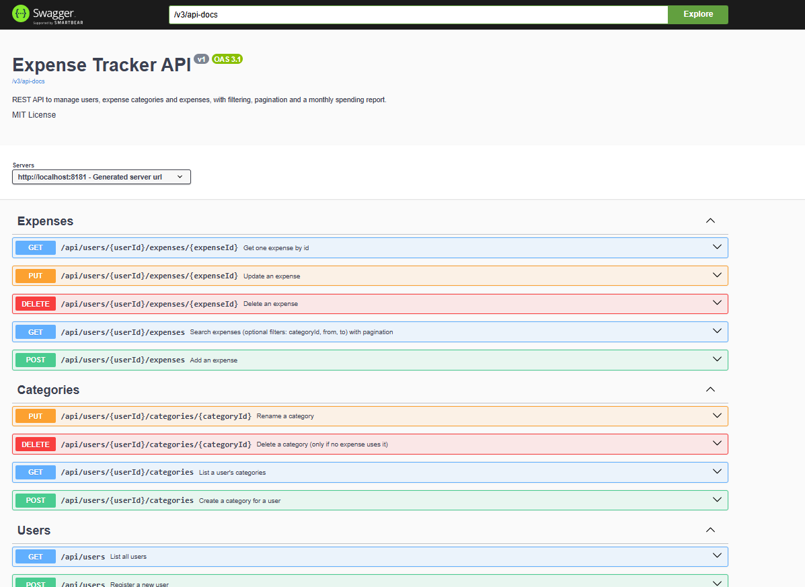
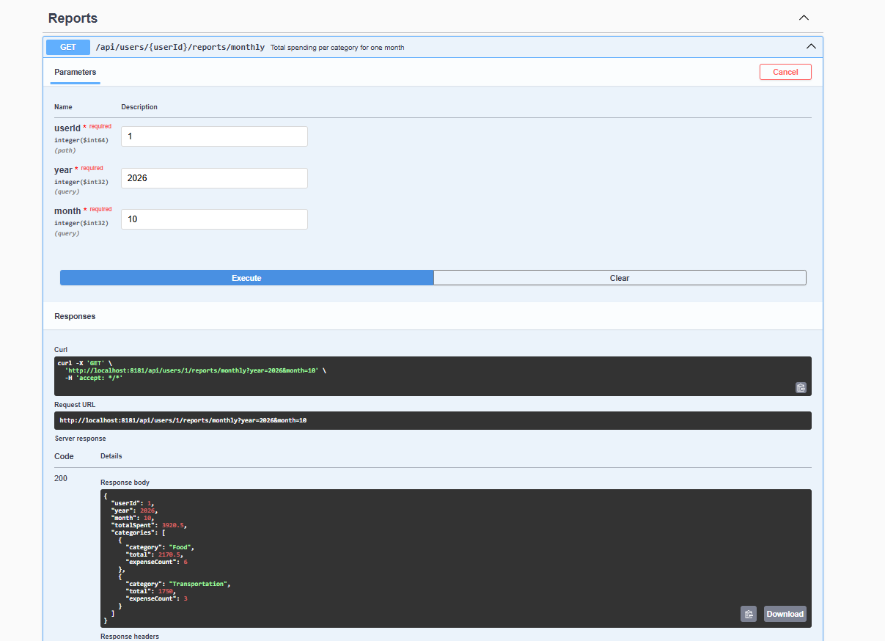

# Expense Tracker REST API

A RESTful web application built using Spring Boot to manage users, expense categories, and expenses. The application supports expense filtering, pagination, and monthly spending reports by category.

## Tech Stack

- **Language:** Java 21
- **Framework:** Spring Boot 3.5
- **Database:** MySQL 
- **ORM:** Spring Data JPA, Hibernate
- **Validation:** Jakarta Bean Validation
- **API Documentation:** Swagger UI, OpenAPI
- **Testing:** JUnit 5, Mockito
- **Build Tool:** Maven

## Features

- Register users with unique email addresses
- Create and manage expense categories
- Perform CRUD operations on expenses
- Search expenses by category and date range
- Support pagination and newest-first sorting
- Generate monthly spending reports by category
- Validate incoming requests and return meaningful error messages
- Handle application exceptions with structured JSON responses
- Explore and test API endpoints using Swagger UI
- Unit test service-layer business logic

## Architecture

The application follows a layered architecture to separate request handling, business logic, and database operations.

```text
Client (Postman / Swagger UI)
           |
      Controller
           |
        Service
           |
       Repository
           |
          MySQL
```

### Package Structure

- `controller` – Handles HTTP requests and responses
- `service` – Implements business logic
- `repository` – Handles database operations using Spring Data JPA
- `entity` – Defines database entities
- `dto` – Transfers request and response data
- `exception` – Handles application errors
- `config` – Contains application configuration

## API Endpoints

### Users

| Method | Endpoint | Description |
|---|---|---|
| POST | `/api/users` | Register a new user |
| GET | `/api/users` | List all users |
| GET | `/api/users/{userId}` | Get user details |

### Categories

| Method | Endpoint | Description |
|---|---|---|
| POST | `/api/users/{userId}/categories` | Create a category |
| GET | `/api/users/{userId}/categories` | List a user's categories |
| PUT | `/api/users/{userId}/categories/{categoryId}` | Rename a category |
| DELETE | `/api/users/{userId}/categories/{categoryId}` | Delete a category |

### Expenses

| Method | Endpoint | Description |
|---|---|---|
| POST | `/api/users/{userId}/expenses` | Add an expense |
| GET | `/api/users/{userId}/expenses` | Search and paginate expenses |
| GET | `/api/users/{userId}/expenses/{expenseId}` | Get an expense by ID |
| PUT | `/api/users/{userId}/expenses/{expenseId}` | Update an expense |
| DELETE | `/api/users/{userId}/expenses/{expenseId}` | Delete an expense |

The expense search endpoint supports optional filters such as `categoryId`, `from`, and `to`, along with `page` and `size` pagination parameters.

### Monthly Reports

| Method | Endpoint | Description |
|---|---|---|
| GET | `/api/users/{userId}/reports/monthly` | Get monthly spending totals by category |

Example:

`GET /api/users/1/reports/monthly?year=2026&month=10`

## Example API Requests

### Register a User

**POST** `/api/users`

```json
{
  "name": "Asha",
  "email": "asha@example.com"
}
```

### Create an Expense Category

**POST** `/api/users/1/categories`

```json
{
  "name": "Food"
}
```

### Add an Expense

**POST** `/api/users/1/expenses`

```json
{
  "amount": 120.50,
  "description": "Lunch",
  "expenseDate": "2026-10-20",
  "categoryId": 1
}
```

Use an existing user ID and a category ID belonging to that user when testing these requests.

## Screenshots

### Swagger UI – API Documentation

Shows the available API endpoints for users, categories, expenses, and monthly reports.



### Create Expense – API Request and Response

Shows the request body and the response returned when an expense is created successfully.



### Monthly Expense Report

Shows the monthly spending report grouped by expense category.


## How to Run the Application

### Prerequisites

- JDK 21
- Maven
- MySQL
- Spring Tool Suite (STS), Eclipse, or IntelliJ IDEA

### Database Configuration

1. Create a MySQL database for the application.
2. Configure the database URL, username, and password in `application.yaml` or `application.properties`.
3. Ensure the database server is running before starting the application.

Example database URL:

```text
jdbc:mysql://localhost:3306/expense_tracker
```

Use the database name and credentials configured in your own application.

### Run the Application

Run the application from your IDE by starting the main Spring Boot application class, or use Maven:

```bash
mvn spring-boot:run
```

The application runs at:

`http://localhost:8181`

### Open Swagger UI

Use Swagger UI to explore endpoints and test API requests:

`http://localhost:8181/swagger-ui/index.html`

OpenAPI documentation is available at:

`http://localhost:8181/v3/api-docs`

### Run Unit Tests

Execute the following command from the project directory:

```bash
mvn test
```

## Screenshots

### Swagger UI – API Documentation


### Create Expense – API Request and Response


### Monthly Expense Report


## Future Improvements

- Add authentication and authorization
- Develop a frontend dashboard for expense tracking
- Add graphical spending analytics
- Improve reporting and financial summaries
